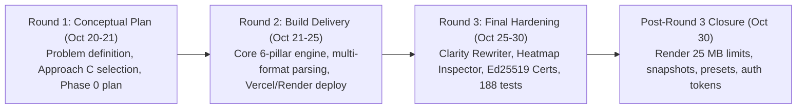
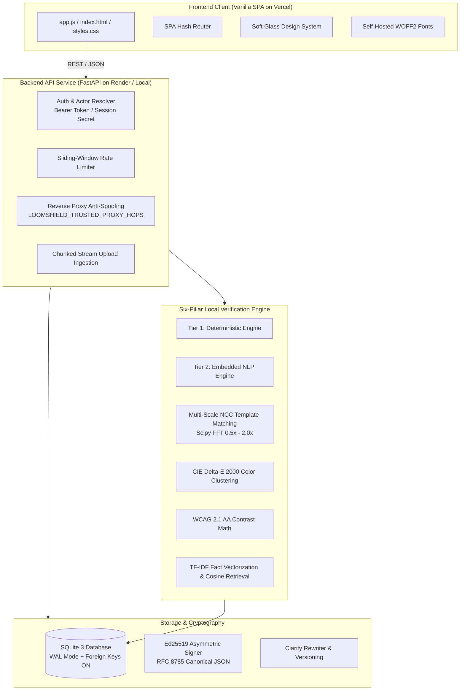
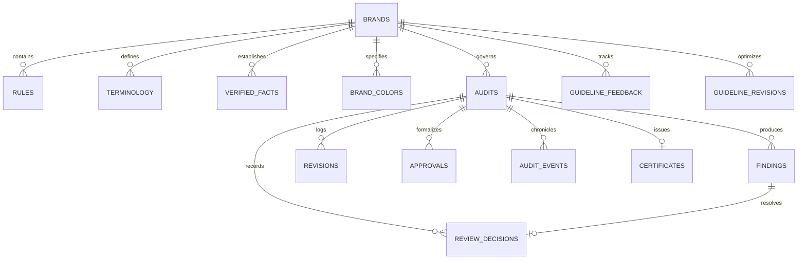
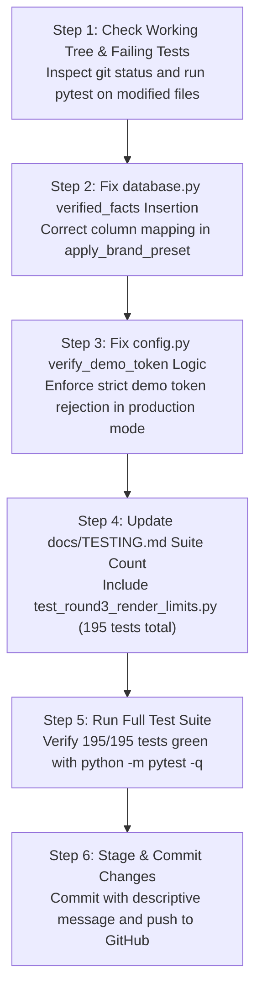

# LOOMSHIELD — COMPLETE PROJECT CONTEXT HANDOFF & ARCHITECTURAL REGISTER

**Document Version:** `1.0.0`  
**Date of Handoff:** `2026-10-30`  
**Target Repository:** `https://github.com/isaacincognito007-cloud/Inkloom-artLoomShield`  
**Project Root Directory:** `D:\LoomShield`  
**Solo Builder / Lead Engineer & Architect:** Isaac Shiloah Herbert V (`isaac.incognito007@gmail.com`)  
**Team Identity:** `isaac.incognito007`  
**Current Git Commit Baseline (Committed):** `f6a24f4` (Docs finalization, Round 3 completion, 188 automated tests passing)  
**Active Working Tree State:** Uncommitted modifications on branch `main` (`backend/config.py`, `backend/database.py`, `backend/engine.py`, `backend/heatmap.py`, `backend/main.py`, and untracked `tests/test_round3_render_limits.py`)

---

## 1. PROJECT OVERVIEW AND OBJECTIVES

### 1.1 Core Mission & Purpose
LoomShield is an enterprise-grade brand governance and compliance validation workspace designed to inspect marketing copy, public relations statements, technical specifications, and visual assets against approved organizational guidelines before publication. 

The primary objective is to eliminate brand compliance drift, prevent costly regulatory fines (e.g., unsubstantiated claims, financial guarantees, deceptive SLAs), and ensure consistent tone, typography, color fidelity, and accessibility across multi-format marketing collateral.

### 1.2 The "Local-First / Zero-Key" Architectural Thesis
Unlike conventional SaaS governance tools that pipe sensitive, unreleased marketing materials and proprietary trade secrets to third-party commercial LLM endpoints (e.g., OpenAI, Anthropic), LoomShield operates on a strict **zero-key local-first architecture**:
- **Zero Mandatory External AI API Keys:** No paid API keys, tokens, or cloud model subscriptions are required.
- **Two In-Memory / On-Device Engines:**
  - **Tier 1: Deterministic Engine:** Case-sensitive and word-boundary lexicons, regex guards, WCAG 2.1 AA relative luminance contrast math ($4.5:1$ and $3.0:1$), CIE Delta-E 2000 color difference clustering, and classical Normalized Cross-Correlation (NCC) template matching with fast Fourier transform (FFT) convolution.
  - **Tier 2: Embedded NLP Engine:** Scikit-Learn TF-IDF vectorizer fitted on-the-fly per request and cosine similarity retrieval combined with numerical and unit conflict extraction against Brand Vault verified facts. Zero neural network weights, zero GPU requirement, zero external network telemetry.
- **Enterprise Confidentiality:** Content is processed ephemerally in-memory and discarded upon completion. Zero bytes of customer copy leak to external AI providers.

### 1.3 Key Operational URLs & Live Deployments
- **Live Frontend (Vercel):** `https://inkloom-artloomshield-frontend.vercel.app`
- **Hosted Backend API (Render):** `https://inkloom-artloomshield.onrender.com`
- **GitHub Repository:** `https://github.com/isaacincognito007-cloud/Inkloom-artLoomShield`
- **Local Development URL:** `http://127.0.0.1:8000`

---

## 2. ORIGINAL REQUIREMENTS AND SUBSEQUENT CHANGES

### 2.1 Hackathon Trajectory & Evolution
The project developed over an intensive 10-day sprint across three competitive hackathon rounds:



- **Round 1 (October 20–21, 2026):**
  - Problem statement centered around brand governance for inkloom.art / Inkloom AI.
  - Evaluation of approaches: Approach A (pure deterministic regex), Approach B (full cloud LLM pipeline), and Approach C (Hybrid Deterministic + Citation-Grounded RAG Governance Studio). Approach C was selected.
  - Deliverable: Comprehensive strategic PDF submission (`Phase0_Verification_and_Plan.md`, `LoomShield_Round1_Plan.html`).
- **Round 2 (October 21–25, 2026):**
  - Transition from theory to production codebase.
  - Development of the six-pillar inspection engine, SQLite database schema, 5-question setup wizard, role-based access control, sliding-window rate limiting, and multi-format file ingestion (.txt, .md, .html, .docx, .pdf, .svg, .png, .jpg).
  - Deployments established on Render (backend) and Vercel (frontend).
  - Deliverable: Working prototype, 103 reconciled tests, and `LoomShield_Project_Submission_Round2.pdf`.
- **Round 3 (October 25–30, 2026):**
  - Implementation of three major commitments declared in Round 2:
    1. *Guideline Clarity Rewriter* (closed-loop ambiguity reduction and atomic Brand Vault versioning).
    2. *Visual Heatmap & Clear-Space Inspector* (grid-based Delta-E 2000, multi-scale NCC logo matching 0.5x–2.0x, WCAG vector text contrast).
    3. *Cryptographically Signed Compliance Certificates (v2)* (Ed25519 signatures, RFC 8785 canonical JSON, separation of duties, public revocation ledger).
  - Hardening cycles: memory budgeting (12 MP cap, 109 MB peak RSS on Windows), removal of committed database from git cache, test suite expansion to 188 passing tests.
  - Deliverable: `LoomShield_Round3_Final_Product_Document.pdf` and complete documentation suite.
- **Round 3 Extension / Post-Submission Hardening (October 30, 2026):**
  - Addressing partially done items: Render free-tier 512 MB RAM upload capacity optimization (25 MB safe cap), database snapshot export/restore for ephemeral container redeployments, production HMAC bearer tokens, and brand guideline presets.

### 2.2 Major Directional Corrections & Critical Shifts
1. **Terminology & Branding Shift:**
   - *Original:* Informal working titles like "Shield Your Loom" or "Shield for Your Loom".
   - *Correction:* Replaced across UI and documentation with professional enterprise terms ("New Audit", "Run Audit", "Audit Workspace", "Brand Vault").
2. **First-Person POV Requirement:**
   - *Original:* Generic team plural ("we", "our").
   - *Correction:* The builder is a solo engineer (Isaac Shiloah Herbert V). All formal submission documents and documentation must strictly use first-person singular ("I", "my") and omit hackathon points/grading rubrics.
3. **No Synthetic / Invented Probabilities:**
   - *Original:* Rule confidence scores expressed as pseudo-probabilistic percentages (e.g. "98% confidence").
   - *Correction:* Outlawed as deceptive. Replaced with exact mathematical TF-IDF cosine similarity scores (e.g., `similarity: 0.94` against `FACT-101`) and deterministic tier tags (`Tier 1`, `Tier 2`).
4. **Deterministic Vector Contrast vs. Heavyweight OCR:**
   - *Original:* Planned optical character recognition (OCR) for all raster images.
   - *Correction:* OCR introduces massive binary dependencies (>150 MB like Tesseract/EasyOCR), high latency, and false positive character bounds. Contrast analysis was focused on genuine vector `<text>` elements in SVG, while raster images are honestly reported as `Not Checked` with an explicit disclosure card.
5. **No Node.js / NPM Build Pipelines:**
   - *Original:* React / TypeScript frontend proposed in early planning.
   - *Correction:* Vanilla HTML5, CSS3, and standard ES6 JavaScript modules with zero npm build step. Served directly by FastAPI or Vercel static hosting, eliminating supply-chain vulnerabilities and compilation overhead.

---

## 3. FEATURES DISCUSSED AND THEIR IMPLEMENTATION STATUS

| Feature Area | Specific Capability | Implementation Status | Test / Verification Reference |
| :--- | :--- | :---: | :--- |
| **Pillar 1: Terminology** | Case-sensitive lexicon lookup, word boundaries, prohibited words | **SHIPPED** | `test_cycle1_A1_correct_preferred_terminology` |
| **Pillar 2: Claims** | Numerical claim extraction, unit conflict detection, TF-IDF cosine matching | **SHIPPED** | `test_cycle1_B1_approved_numerical_claim` |
| **Pillar 3: Tone & Voice** | Ambiguity scoring, vague phrase lexicon, alarmist tone flags | **SHIPPED** | `test_b1_scorer_determinism_with_golden_fixtures` |
| **Pillar 4: Messaging** | Mandatory human-oversight clauses, structure guards | **SHIPPED** | `test_cycle1_B10_claims_that_require_human_verification_pending_fact` |
| **Pillar 5: Visuals** | Delta-E 2000 palette clustering, multi-scale NCC logo matching (0.5x–2.0x) | **SHIPPED** | `test_h2_heatmap_fixture_suite_against_expected_json` |
| **Pillar 6: Accessibility** | WCAG 2.1 AA contrast math ($4.5:1$ / $3.0:1$), heading jumps, alt-text | **SHIPPED** | `test_cycle1_C1_sufficient_text_contrast` |
| **Setup Wizard** | 5-question wizard dynamically composing brand profiles from 22 fragments | **SHIPPED** | `test_wizard_profile_creation_atomic_and_never_modifies_existing_brands` |
| **Audit Workflow** | Draft -> In Review -> Changes Requested -> Approved | **SHIPPED** | `test_workflow_transitions_and_cas_concurrency` |
| **Finding Actions** | Concurrency-protected Accept (with replacement) and Dismiss (with rationale) | **SHIPPED** | `test_correction_accept_modify_dismiss_and_workflow_approval` |
| **Compliance Lock** | Post-approval cryptographic content lock preventing silent edits | **SHIPPED** | `test_workflow_transitions_and_cas_concurrency` |
| **Rate Limiter** | Sliding-window in-memory limiter (30 req/min audit, 300 req/min global) | **SHIPPED** | `test_rate_limiting_429_on_audit_upload_and_reset` |
| **Proxy Anti-Spoofing** | Right-to-left `X-Forwarded-For` parsing (`LOOMSHIELD_TRUSTED_PROXY_HOPS`) | **SHIPPED** | `test_h8_get_client_ip_render_proxy_anti_spoofing` |
| **File Parsers** | Ingests `.txt`, `.md`, `.html`, `.docx`, `.pdf`, `.svg`, `.png`, `.jpg` | **SHIPPED** | `test_loomshield_pdf.py`, `test_cycle2_integration_tests_1_to_5` |
| **Clarity Rewriter** | Vague rule scoring, fact-grounded rewrites, Before/After loop metrics | **SHIPPED** | `test_h1_clarity_rewriter_before_after_loop_closure_metrics` |
| **Visual Heatmap** | 4x4 / NxN grid overlay, SVG vector contrast, clear-space distance | **SHIPPED** | `test_h2_vault_approved_logo_upload_delete_and_clear_space_api` |
| **Signed Certificates** | Ed25519 asymmetric signatures, canonical JSON, revocation ledger | **SHIPPED** | `test_h3_certificate_v2_new_blocks_invariance_revocation_and_v1_compatibility` |
| **Separation of Duties** | Submitter cannot self-approve audit (`submitted_by_user_id != approver`) | **SHIPPED** | `test_self_approval_blocked_and_different_reviewer_succeeds` |
| **Memory Budgeting** | 12.0 Megapixel cap ($12,000,000$ px), 109 MB peak Windows memory | **SHIPPED** | `test_g2_image_cap_12mp_accepted_and_12mp_plus_1px_rejected` |
| **Typography Rules** | Programmatic font family & size checking in engine via SVG extraction | **IN PROGRESS** | `tests/test_round3_render_limits.py::test_typography_rule_enforcement_in_engine` |
| **Render Free Limits** | Configurable upload limit (default 25 MB on Render), `/api/system/limits` | **IN PROGRESS** | `tests/test_round3_render_limits.py::test_system_limits_and_render_free_profile` |
| **Database Snapshot** | JSON database backup & restore across ephemeral Render redeploys | **IN PROGRESS** | `tests/test_round3_render_limits.py::test_database_snapshot_export_and_restore` |
| **Production Auth Tokens**| HMAC-SHA256 bearer tokens for production accounts (`usr_admin`, etc.) | **IN PROGRESS** | `tests/test_round3_render_limits.py::test_production_user_authentication` |
| **Brand Presets Catalog** | Pre-baked profiles (`novapay`, `verdant`, `acmecorp`, `finsafe`) | **IN PROGRESS** | `tests/test_round3_render_limits.py::test_brand_presets_catalog_and_apply` |
| **100 MB Stream Uploads** | Background worker streaming chunks directly to disk (`SpooledTemporaryFile`) | **DEFERRED (ROADMAP)** | Documented in `docs/ROADMAP.md` Section 2.2 |
| **Raster OCR** | Local quantized ONNX OCR for flattened PNG/JPG marketing banners | **DEFERRED (ROADMAP)** | Documented in `docs/ROADMAP.md` Section 3.4 |
| **Threaded Inline Comments**| Multi-user character-span comment threads on draft text | **DEFERRED (ROADMAP)** | Documented in `docs/ROADMAP.md` Section 2.3 |
| **Vault Bulk Archive** | `.loomshield-vault.json` signed archive import/export | **DEFERRED (ROADMAP)** | Documented in `docs/ROADMAP.md` Section 2.4 |

---

## 4. TECHNOLOGY STACK, FRAMEWORKS, LIBRARIES, AND ARCHITECTURE

### 4.1 Technology Stack & Pinned Dependencies
- **Backend Runtime:** Python 3.11 (tested on Windows AMD64 and Linux Render containers).
- **Web API Framework:** `fastapi>=0.115.0`, `uvicorn>=0.30.0`.
- **Data Validation & Schemas:** `pydantic>=2.8.0`.
- **Multipart Form Ingestion:** `python-multipart>=0.0.9`.
- **Image Processing & Computer Vision:** `pillow>=10.4.0`, `numpy>=1.26.0`, `scipy>=1.11.0` (fast 2D FFT convolution for normalized cross-correlation).
- **Natural Language Processing & Machine Learning:** `scikit-learn>=1.5.0` (`TfidfVectorizer`, linear algebra cosine similarity).
- **Document & File Parsers:** `python-docx>=1.1.0`, `beautifulsoup4>=4.12.0`, `pypdf>=5.0.0`.
- **Cryptographic Engine:** `cryptography==50.0.2` (Ed25519 signing and verification primitives, RFC 8032).
- **Testing & Quality Assurance:** `pytest>=8.0.0`, `httpx>=0.27.0`, `playwright>=1.40.0` (end-to-end browser automation).
- **Frontend Architecture:** Vanilla HTML5, modern CSS3 (Custom Properties & Soft Glass design system), vanilla ES6 JavaScript modules. Zero npm/Node.js build chain.

### 4.2 System Architecture Diagram



---

## 5. FRONTEND AND BACKEND STRUCTURE

### 5.1 Project Directory Hierarchy

```
D:\LoomShield
├── backend/
│   ├── rulesets/                     # 22 validated rule fragments
│   │   ├── industry/                 # SaaS, Fintech, Healthcare, E-commerce, AI, Developer Tools
│   │   ├── locale/                   # US, UK, EU, Global, Canada, APAC
│   │   ├── occasion/                 # Launch, General, BFCM, Investor, Crisis, Enterprise
│   │   └── tone/                     # Technical, Confident, Friendly, Formal
│   ├── certificates.py               # Canonical JSON serialization, Ed25519 signing/verification
│   ├── clarity_rewriter.py           # Ambiguity scoring, fact-grounded rewrites, loop metrics
│   ├── config.py                     # Environment variables, role gating, demo tokens, client IP
│   ├── database.py                   # SQLite schemas, migrations, CRUD, presets, snapshot backup
│   ├── engine.py                     # Six-pillar engine pipeline, Tier 1 & Tier 2 processing
│   ├── heatmap.py                    # Classical CV, multi-scale NCC, clear space, SVG vector text
│   ├── main.py                       # 65 FastAPI REST endpoints, middleware, error handlers
│   ├── rate_limiter.py               # In-memory sliding-window rate limiting
│   ├── vague_lexicon.json            # Vague phrase dictionary for ambiguity analysis
│   └── wizard.py                     # 5-question audit setup wizard & composition logic
├── frontend/
│   ├── fonts/
│   │   ├── GeistMono-Variable.woff2  # Self-hosted monospace font for IDs, hashes, versions
│   │   └── InterVariable.woff2       # Self-hosted sans-serif font for UI and body text
│   ├── app.js                        # Monolithic ES6 frontend application logic (AppState, Router, Views)
│   ├── index.html                    # Single-page HTML shell with semantic accessible markup
│   ├── styles.css                    # Complete CSS stylesheet with Soft Glass tokens
│   ├── vercel.json                   # Vercel deployment routes and asset caching rules
│   └── favicon.*                     # Multi-resolution SVG/PNG/ICO favicon suite
├── docs/
│   ├── ARCHITECTURE.md               # Subsystem architecture, engine tiers, data flows
│   ├── DEVIATIONS.md                 # Cumulative register of all architectural deviations
│   ├── FIXTURE_REPORT.md             # Empirical fixture report for Visual Heatmap Inspector
│   ├── IMPROVEMENTS.md               # Round 3 improvements specification & evaluator script
│   ├── ROADMAP.md                    # Strategic product roadmap & sketches for future phases
│   ├── TESTING.md                    # Test harness documentation and suite accounting
│   ├── TEST_CYCLES_REPORT.md         # Measured latency benchmarks and performance telemetry
│   ├── auth-plan.md                  # Future enterprise SSO/OIDC production identity plan
│   ├── final_pdf_data.json           # Machine-readable telemetry extracted for final PDF
│   └── submission_answers.txt        # Concise Round 2 submission Q&A text
├── scripts/
│   ├── build_final_pdf.py            # ReportLab script generating the official submission PDF
│   ├── collect_final_facts.py        # Automated empirical facts harvester for docs & PDF
│   ├── generate_fixture_report.py    # Fixture runner updating FIXTURE_REPORT.md
│   ├── generate_signing_key.py       # Utility to generate Ed25519 32-byte seed for env vars
│   ├── verify_certificate.py         # Offline CLI verifier for Ed25519 compliance certificates
│   └── verify_final_pdf.py           # Integrity validator for generated PDF document
├── tests/
│   ├── e2e/
│   │   └── test_ui_e2e.py            # Playwright end-to-end tests for UI viewports and user journeys
│   ├── fixtures/banners/             # 12 labelled SVG/PNG banners + 3 extended scale/decoy fixtures
│   ├── conftest.py                   # Pytest fixtures and test environment bootstrap
│   ├── test_certificates_and_identities.py  # 24 tests: Ed25519, canonical JSON, separation of duties
│   ├── test_clarity_rewriter.py      # 13 tests: ambiguity scoring, atomic versioning, loop metrics
│   ├── test_day3_final_hardening.py  # 6 tests: 12 MP cap, memory budgeting, tier labels
│   ├── test_heatmap_inspector.py     # 18 tests: NCC template matching, Delta-E, clear space
│   ├── test_loomshield_api.py        # 10 tests: REST contracts, audit CRUD, workflow transitions
│   ├── test_loomshield_cycles_0_to_9.py # 43 tests: foundational cycles 0 to 9, regex, WCAG math
│   ├── test_loomshield_pdf.py        # 15 tests: PDF text extraction, multi-page spans, magic bytes
│   ├── test_loomshield_trust_safety.py  # 40 tests: RBAC, CAS concurrency, rate limiting, anti-spoof
│   ├── test_round3_render_limits.py  # 7 untracked tests: Render limits, snapshots, presets, auth
│   └── test_wizard.py                # 16 tests: wizard composition, isolated brands, ReDoS safety
├── requirements.txt                  # Production dependencies
├── requirements-dev.txt              # Development dependencies (pytest, playwright)
├── run_loomshield.py                 # Convenience local server launch script
└── README.md                         # Project documentation and evaluator quickstart
```

---

## 6. DATABASE DESIGN, MODELS, AND RELATIONSHIPS

### 6.1 Database Engine & Pragma Guarantees
- **Engine:** SQLite 3 in Write-Ahead Logging mode (`PRAGMA journal_mode = WAL;`).
- **Integrity:** Referential integrity strictly enforced on every connection (`PRAGMA foreign_keys = ON;`).
- **Isolation:** Tests use dedicated ephemeral databases via `LOOMSHIELD_DB_PATH` or `:memory:`.

### 6.2 Entity Relationship Diagram



### 6.3 Complete Table Schema Catalog (15 Tables)

1. `brands`: Core brand guideline profiles.
   - `id` (TEXT PK), `name`, `industry`, `description`, `tone_principles`, `writing_style`, `messaging_principles`, `do_examples`, `dont_examples`, `typography_specs`, `spacing_rules`, `logo_placement_constraints`, `min_contrast_normal` (REAL 4.5), `min_contrast_large` (REAL 3.0), `require_alt_text` (INT 1), `enforce_heading_order` (INT 1), `target_reading_ease` (REAL 60.0), `version` (INT 1), `updated_at`.
2. `rules`: Compliance rules across the six pillars.
   - `id` (TEXT PK), `brand_id` (FK), `pillar`, `title`, `description`, `rule_config_json`, `severity` (error/warning/info), `do_example`, `dont_example`, `active` (INT 1), `version` (INT 1), `updated_at`.
3. `terminology`: Prohibited, preferred, and replacement terms.
   - `id` (TEXT PK), `brand_id` (FK), `preferred_term`, `prohibited_term`, `replacement_term`, `case_sensitive` (INT 0), `notes`, `rule_id`, `updated_at`.
4. `verified_facts`: Verified ground truths for promotional claim substantiation.
   - `id` (TEXT PK), `brand_id` (FK), `statement` (TEXT NOT NULL), `numeric_value`, `numeric_units`, `product_context`, `source_reference`, `applicable_conditions`, `date_version`, `verification_status` ('Verified'), `updated_at`.
5. `brand_colors`: Approved brand color palette.
   - `id` (TEXT PK), `brand_id` (FK), `name`, `hex_code`, `usage_role` (primary/secondary/accent/background), `max_delta_e` (REAL 14.0).
6. `audits`: Content audit records.
   - `id` (TEXT PK, e.g. `AUD-XXXX`), `brand_id` (FK), `brand_version` (INT), `document_name`, `input_format` (txt/md/html/docx/pdf/svg/png/jpg), `original_content`, `current_content`, `fg_color`, `bg_color`, `image_alt_text`, `has_visual_asset` (INT), `visual_metadata_json`, `confidential_mode` (INT 1), `overall_status` ('Draft'/'In Review'/'Changes Requested'/'Approved'), `assigned_reviewer`, `submitted_by_user_id`, `submitted_by_name`, `submitted_by_role`, `created_at`, `updated_at`.
7. `findings`: Granular compliance violations.
   - `id` (TEXT PK), `audit_id` (FK), `pillar`, `issue_type`, `severity`, `flagged_text`, `paragraph_ref`, `start_index`, `end_index`, `rule_or_fact_id`, `source_evidence`, `explanation`, `suggested_correction`, `detection_method`, `engine_source` ('Tier 1' / 'Tier 2'), `resolution_status` ('Open'/'Accepted'/'Dismissed'), `resolution_comment`, `resolved_by`, `resolved_at`, `created_at`.
8. `revisions`: Immutable text snapshot history of draft edits.
   - `id` (INT PK AUTO), `audit_id` (FK), `version_number`, `previous_content`, `revised_content`, `editor_role`, `change_summary`, `created_at`.
9. `review_decisions`: Decisions made on findings.
   - `id` (INT PK AUTO), `audit_id` (FK), `finding_id` (FK), `decision` ('accept'/'modify'/'dismiss'), `replacement_applied`, `reason`, `reviewer_role`, `created_at`.
10. `approvals`: Formal audit sign-off records.
    - `id` (INT PK AUTO), `audit_id` (FK), `previous_state`, `new_state`, `approver_role`, `version_reviewed`, `unresolved_findings_count`, `override_acknowledged`, `comment`, `content_sha256`, `created_at`.
11. `guideline_feedback`: Telemetry on reviewer overrides feeding the Clarity Rewriter.
    - `id` (INT PK AUTO), `brand_id` (FK), `rule_id` (FK), `audit_id` (FK), `finding_id` (FK), `override_reason`, `suspected_cause`, `admin_review_state`, `created_at`.
12. `audit_events`: Tamper-evident audit timeline log.
    - `id` (INT PK AUTO), `audit_id` (FK), `event_type`, `actor_name`, `actor_role`, `actor_user_id`, `summary`, `detail_json`, `version_number`, `created_at`.
13. `certificates`: Cryptographically signed compliance certificates.
    - `id` (TEXT PK, e.g. `CERT-XXXX`), `audit_id` (FK UNIQUE), `payload_json`, `signature` (Base64 Ed25519), `kid` (Key ID), `issued_at`, `issued_by`.
14. `demo_users`: Demo persona directory.
    - `user_id` (TEXT PK), `name`, `initials`, `role`, `title`.
15. `guideline_revisions`: Closed-loop rule revisions generated by Clarity Rewriter.
    - `id` (TEXT PK), `brand_id`, `rule_id`, `old_text`, `new_text`, `do_examples`, `dont_examples`, `ambiguity_before`, `ambiguity_after`, `status` ('proposed'/'approved'/'rejected'), `rejection_reason`, `created_by`, `created_at`, `decided_by`, `decided_at`, plus Before/After telemetry metrics (`before_violations`, `before_overrides`, `before_dismissals`, `before_override_rate_pct`, `after_violations`, `after_overrides`, `after_dismissals`, `after_override_rate_pct`, `after_sample_count`, `before_sample_count`).

---

## 7. APIS, INTEGRATIONS, AUTHENTICATION, AND AUTHORIZATION

### 7.1 Authentication Architecture
- **Demo Mode (`LOOMSHIELD_WORKSPACE_MODE=demo`):**
  - Personas: Content Creator (`usr_creator`), Reviewer (`usr_reviewer`), Brand Administrator (`usr_admin`).
  - Endpoint `POST /api/demo/login` issues an HMAC-SHA256 signed bearer token with an 8-hour TTL signed by `LOOMSHIELD_SESSION_SECRET`.
  - Stored in browser `sessionStorage` for seamless refresh without persistent state pollution.
- **Production Mode (`LOOMSHIELD_WORKSPACE_MODE=production`):**
  - Requires valid `Authorization: Bearer <token>` signed with server session secret.
  - Persona directory: `usr_admin` (Brand Administrator), `usr_auditor` (Reviewer), `usr_legal` (Reviewer).
  - Unauthenticated requests default to server environment variables (`LOOMSHIELD_USER_ROLE`, `LOOMSHIELD_USER_NAME`).
  - Separation of duties: sub-system checks ensure `submitted_by_user_id != approver_user_id`.

### 7.2 Rate Limiting & Proxy Anti-Spoofing
- In-memory sliding-window rate limiting (`rate_limiter.py`):
  - `POST /api/audits` & `POST /api/audits/upload`: 30 requests/minute.
  - `POST /api/demo/reset`: 5 requests/minute (with 10-minute global cooldown).
  - Global ceiling: 300 requests/minute per client IP.
- Anti-spoofing IP resolution (`get_client_ip` in `backend/config.py`):
  - Cloud proxies (Render, Cloudflare) append client hops to the *right* of `X-Forwarded-For`.
  - Configured by `LOOMSHIELD_TRUSTED_PROXY_HOPS` (default `N=1`). The engine selects the Nth IP from the right, preventing attacker-forged leftmost headers from bypassing rate limits (`test_h8_get_client_ip_render_proxy_anti_spoofing`).
  - Explicit header override supported via `LOOMSHIELD_CLIENT_IP_HEADER` (e.g. `CF-Connecting-IP`).

### 7.3 Complete API Route Registry (65 Endpoints)

| Method | Path | Function & Role Restriction |
| :--- | :--- | :--- |
| `GET` | `/api/health` | Healthcheck (checks DB, engine, returns version & status) |
| `GET` | `/api/_diag/client-ip` | Diagnostic IP resolution check |
| `GET` | `/api/engine-status` | Reports Tier 1 & Tier 2 availability, key status, limitations |
| `POST` | `/api/engine-selftest` | Executes 6-pillar self-test assertions |
| `GET` | `/api/session` | Resolves active user, role, permissions, and mode |
| `GET` | `/api/demo/users` | Lists available demo accounts |
| `POST` | `/api/demo/login` | Authenticates demo persona and returns signed token |
| `POST` | `/api/auth/login` | Production login endpoint |
| `GET` | `/api/auth/me` | Current authenticated actor metadata |
| `POST` | `/api/auth/logout` | Session invalidation acknowledgement |
| `GET` | `/api/system/limits` | Exposes upload caps, RAM thresholds, and Render free profile |
| `GET` | `/api/brands/presets` | Lists benchmark brand presets (NovaPay, Verdant, AcmeCorp) |
| `POST` | `/api/brands/presets/{preset_id}/apply` | Applies brand preset (Admin only) |
| `POST` | `/api/database/snapshot/export` | Backs up database to JSON snapshot (Admin only) |
| `POST` | `/api/database/snapshot/restore` | Restores database from JSON snapshot (Admin only) |
| `POST` | `/api/demo/reset` | Resets demo workspace to golden seeded baseline (10-min cooldown) |
| `GET` | `/api/brands` | Lists all brand guideline profiles |
| `POST` | `/api/brands` | Creates new brand guideline profile (Admin only) |
| `GET` | `/api/wizard/options` | Retrieves industry, locale, occasion, tone options for wizard |
| `POST` | `/api/wizard/preview` | Generates preview of rules composed by wizard choices |
| `POST` | `/api/wizard/profile` | Creates isolated brand profile from wizard choices |
| `GET` | `/api/overview/{brand_id}` | Overview KPIs, recent audits, rules summary |
| `GET` | `/api/vault/{brand_id}` | Complete Brand Vault details (rules, terms, facts, colors) |
| `PUT` | `/api/vault/{brand_id}/voice` | Updates tone and writing principles (Admin only) |
| `PUT` | `/api/vault/{brand_id}/visual-specs` | Updates typography, spacing, logo constraints (Admin only) |
| `PUT` | `/api/vault/{brand_id}/accessibility-rules` | Updates WCAG contrast thresholds (Admin only) |
| `POST` | `/api/vault/{brand_id}/terminology` | Adds terminology entry (Admin only) |
| `PUT` | `/api/vault/{brand_id}/terminology/{term_id}`| Updates terminology entry (Admin only) |
| `DELETE`| `/api/vault/{brand_id}/terminology/{term_id}`| Deletes terminology entry (Admin only) |
| `POST` | `/api/vault/{brand_id}/facts` | Adds verified factual statement (Admin only) |
| `PUT` | `/api/vault/{brand_id}/facts/{fact_id}` | Updates verified fact (Admin only) |
| `PUT` | `/api/vault/{brand_id}/facts/{fact_id}/status`| Toggles fact verification status (Admin only) |
| `DELETE`| `/api/vault/{brand_id}/facts/{fact_id}` | Deletes verified fact (Admin only) |
| `POST` | `/api/vault/{brand_id}/colors` | Adds brand color (Admin only) |
| `PUT` | `/api/vault/{brand_id}/colors/{color_id}` | Updates brand color (Admin only) |
| `DELETE`| `/api/vault/{brand_id}/colors/{color_id}` | Deletes brand color (Admin only) |
| `POST` | `/api/vault/{brand_id}/logo` | Uploads approved reference logo mark (Admin only) |
| `DELETE`| `/api/vault/{brand_id}/logo` | Deletes reference logo mark (Admin only) |
| `PUT` | `/api/vault/{brand_id}/clear-space` | Updates logo clear-space requirements (Admin only) |
| `POST` | `/api/vault/{brand_id}/rules` | Adds custom guideline rule (Admin only) |
| `PUT` | `/api/vault/{brand_id}/rules/{rule_id}` | Updates rule configuration (Admin only) |
| `DELETE`| `/api/vault/{brand_id}/rules/{rule_id}` | Deletes rule (Admin only) |
| `POST` | `/api/audits` | Submits text content for compliance audit |
| `POST` | `/api/audits/upload` | Ingests multi-format file upload for compliance audit |
| `GET` | `/api/audits` | Lists audit history with status filtering |
| `GET` | `/api/audits/{audit_id}` | Full audit details, findings, revisions, and certificate |
| `POST` | `/api/audits/{audit_id}/findings/{finding_id}/decision` | Accepts or dismisses finding with CAS concurrency guard |
| `POST` | `/api/audits/{audit_id}/workflow` | Transitions audit status (Draft -> In Review -> Approved) |
| `POST` | `/api/audits/{audit_id}/certificate` | Issues Ed25519 signed compliance certificate (Admin/Reviewer) |
| `GET` | `/api/audits/{audit_id}/certificate` | Retrieves existing certificate payload & signature |
| `GET` | `/api/certificates/public-key` | Publishes active Ed25519 public key and Key ID (kid) |
| `POST` | `/api/certificates/verify` | Verifies cryptographic certificate validity & payload invariance |
| `POST` | `/api/certificates/{certificate_id}/revoke`| Administratively revokes certificate with reason (Admin only) |
| `GET` | `/api/certificates/{certificate_id}/status` | Public status check without exposing content hashes |
| `POST` | `/api/audits/{audit_id}/rerun` | Re-executes audit inspection against current draft text |
| `GET` | `/api/ambiguity-radar/{brand_id}` | Analyzes guideline ambiguity and override friction |
| `POST` | `/api/ambiguity-radar/{brand_id}/rules/{rule_id}/propose` | Generates candidate rule rewrite grounded in facts |
| `POST` | `/api/ambiguity-radar/{brand_id}/revisions/{revision_id}/approve` | Atomically approves rewrite, bumps version, logs metrics |
| `POST` | `/api/ambiguity-radar/{brand_id}/rules/{rule_id}/approve` | Direct rule rewrite approval |
| `POST` | `/api/ambiguity-radar/{brand_id}/revisions/{revision_id}/reject` | Rejects proposed revision with rationale |
| `POST` | `/api/audits/{audit_id}/heatmap` | Computes visual Delta-E and clear-space heatmap inspection |

---

## 8. USER ROLES AND THEIR RESPONSIBILITIES

LoomShield enforces role-based access control (RBAC) across three distinct enterprise personas:

| Role | Responsibility & Gated Capabilities | Prohibited Operations |
| :--- | :--- | :--- |
| **Content Creator** (`usr_creator`) | Drafts marketing copy, uploads multi-format documents, initiates audits, edits draft text, views findings, accepts suggested replacements. | Cannot approve audits (`HTTP 403`), cannot issue compliance certificates (`HTTP 403`), cannot modify Brand Vault rules/terms/facts (`HTTP 403`). |
| **Reviewer / Compliance Auditor** (`usr_reviewer` / `usr_auditor`) | Audits submissions, reviews flagged findings, evaluates human overrides, dismisses false positives with documented rationale, approves compliant audits. | Cannot self-approve audits they submitted (Separation of Duties; `HTTP 403`). Cannot edit core Brand Vault rules or delete reference logos (`HTTP 403`). |
| **Brand Administrator** (`usr_admin`) | Full governance oversight. Manages Brand Vault rules, terminology, verified facts, and approved logos. Approves guideline revisions from Clarity Rewriter, revokes certificates, exports/restores snapshots. | Bound by separation of duties on audits they submit. Subject to rate limits and CAS concurrency guards. |

---

## 9. IMPORTANT WORKFLOWS AND BUSINESS LOGIC

### 9.1 Six-Pillar Content Inspection Pipeline
When content is submitted (`POST /api/audits` or `/upload`):
1. **Pillar 1 (Terminology):** Tokenizes text into word-boundary spans. Checks against active prohibited terms dictionary. Trims punctuation while preserving exact indices. Emits suggested replacement.
2. **Pillar 2 (Promotional Claims):** Extracts numbers, percentages, and units ($X\%$, $\$Y$, $Z\text{ ms}$). Compares against `verified_facts` table using TF-IDF cosine similarity. Claims with cosine similarity $\ge 0.35$ are matched; claims with conflicting numerical values emit High severity findings; claims with no vault match emit "Needs Review" findings.
3. **Pillar 3 (Tone & Voice):** Scans against `vague_lexicon.json` for alarmist, hyperbolic, or vague phrases ("market-leading", "guaranteed", "revolutionary"). Emits tone advisory warnings.
4. **Pillar 4 (Messaging Principles):** Evaluates mandatory inclusion rules (e.g. required disclaimers, human-oversight clauses for AI products).
5. **Pillar 5 (Visual Consistency):** When images or SVGs are attached: runs grid-based CIE Delta-E 2000 dominant color analysis against `brand_colors`. Runs multi-scale normalized cross-correlation (NCC) to locate reference logos and measures distance to boundaries.
6. **Pillar 6 (Accessibility):** Computes WCAG 2.1 relative luminance:
   $$L = 0.2126 \cdot R + 0.7152 \cdot G + 0.0722 \cdot B$$
   $$\text{Contrast Ratio} = \frac{L_1 + 0.05}{L_2 + 0.05}$$
   Requires $\ge 4.5:1$ for normal text, $\ge 3.0:1$ for large text. Checks heading hierarchy order and image `alt` attribute presence.

### 9.2 Finding Resolution & CAS Concurrency
Findings must be resolved before audit sign-off:
- **Accept Finding:** Replaces flagged text span with suggested correction, logs an audit revision, and marks finding `Accepted`.
- **Dismiss Finding:** Requires a mandatory text rationale explaining the business justification, records an override in `guideline_feedback`, and marks finding `Dismissed`.
- **Compare-And-Swap (CAS):** Action requests include expected `current_status`. If another reviewer concurrently modified the finding, `HTTP 409 Conflict` is returned to prevent overwrites.

### 9.3 Cryptographic Certificate Issuance & Verification (v2)
Upon reaching `Approved` status:
1. Canonical JSON payload constructed with strictly sorted keys and compact delimiters (RFC 8785 compatible).
2. Content SHA-256 hash, brand version, approver ID, submitter ID, and timestamp sealed.
3. Asymmetric Ed25519 private key signs the canonical UTF-8 bytes.
4. Signed certificate envelope stored in `certificates` table.
5. Verification endpoint (`POST /api/certificates/verify`) verifies signature against published public key and checks public revocation ledger (`GET /api/certificates/{id}/status`).
6. Flipping, inserting, or removing any byte in the envelope or payload breaks mathematical verification.

### 9.4 Guideline Clarity Rewriter Closed Loop
1. Evaluates rule override and dismissal frequency from `guideline_feedback`.
2. Computes rule ambiguity score based on vagueness indicators, missing metrics, and override rate (threshold: $\ge 5$ audits).
3. Candidate generator retrieves verified facts via TF-IDF cosine similarity ($\ge 0.35$) and injects verified numeric thresholds. If no fact matches, explicit placeholders (`[SET THRESHOLD: unit]`) prevent hallucination.
4. Admin approval atomically updates rule description, increments brand version ($V \rightarrow V+1$), creates immutable revision log, and tracks Before vs. After violation/override rates.

---

## 10. UI/UX REQUIREMENTS AND DESIGN DECISIONS

### 10.1 Soft Glass Design System
- **Philosophy:** Clean, modern, light SaaS aesthetic ("Soft Glass"). Avoids heavy, distracting gradients or unreadable blurs.
- **Tokens (`styles.css`):**
  - Spacing scale: `--space-4: 4px` to `--space-48: 48px`.
  - Radii: `--radius-control: 8px`, `--radius-card: 12px`, `--radius-hero: 16px`, `--radius-modal: 16px`.
  - Glass parameters: `--glass-bg: rgba(255, 255, 255, 0.72)`, `--glass-blur: 12px`.
- **Strict Performance Boundary:** Enforces a maximum of 3 concurrent `backdrop-filter` elements across any viewport to prevent mobile and browser rendering lag.
- **Cards & Data Tables:** Solid backgrounds (`--surface-card`) used for dense data tables and metric cards (`backdrop-filter: none`).

### 10.2 Responsive Viewport Contracts
- **Desktop (1280px):** Persistent 240px sidebar navigation (`#appSidebar`), multi-column layout, full findings inspector.
- **Tablet (768px):** Data table headers hidden (`thead display: none`), rows transformed into stacked card format, touch targets guaranteed $\ge 44\text{px}$.
- **Mobile (375px):** Single-column stacked layout, sliding off-canvas drawer navigation, responsive typography.

### 10.3 Single-Page Hash Routing & Navigation
- Hash-based router in `app.js` handles:
  - `#/overview`: KPI dashboard, launch card, evaluator quickstart walkthrough.
  - `#/new-audit`: Setup wizard & multi-format content submission studio.
  - `#/audit/{id}`: Detailed audit findings inspector, revision diffs, certificate view.
  - `#/vault`: Brand guidelines manager (Tone, Rules, Facts, Colors, Logo).
  - `#/queue`: Workflow review queue with status filters.
  - `#/insights`: Guideline ambiguity radar and Clarity Rewriter interface.
  - `#/history`: Comprehensive audit archive.
  - `#/settings`: Workspace configuration and demo reset controls.
  - `#/verify`: Public certificate verification portal.

---

## 11. BUGS, ERRORS, AND TROUBLESHOOTING HISTORY

### 11.1 Render Ephemeral Deployment Failures & Fixes
- **Issue:** Backend deployment failed on Render with exit code crashes and container timeouts.
- **Root Cause:** Render automatically sets dynamic `$PORT` environment variable. Hardcoded host/port configurations in uvicorn scripts caused port binding mismatches. Additionally, database connections failed when SQLite paths lacked directory write permissions.
- **Resolution:** 
  - Bound uvicorn to `0.0.0.0` and `int(os.environ.get("PORT", 8000))`.
  - Implemented dynamic database path resolution (`LOOMSHIELD_DB_PATH`) defaulting to local writeable directories.
  - Added `/api/health` lightweight endpoint returning HTTP 200 without blocking on heavy migrations for Render health probes.

### 11.2 Proxy Anti-Spoofing & Client IP Vulnerability
- **Issue:** Rate limiters were easily bypassed by malicious clients injecting arbitrary `X-Forwarded-For: 1.2.3.4` headers.
- **Root Cause:** Standard reverse proxy parsers read the leftmost entry of `X-Forwarded-For`. Render and cloud proxies append trusted client IPs to the *right*.
- **Resolution:** Implemented right-anchored hop resolution in `backend/config.py` controlled by `LOOMSHIELD_TRUSTED_PROXY_HOPS` (default `1`). Tested and locked via `test_h8_get_client_ip_render_proxy_anti_spoofing`.

### 11.3 Pillow Image Memory Spikes & 12 MP Cap
- **Issue:** Processing a 16 Megapixel ($4000 \times 4000$) marketing image caused peak memory to spike by 158–204 MB, risking OOM kills on Render's 512 MB free tier.
- **Root Cause:** Pillow decompressing unbuffered raster images into multiple full-size RGBA representations across independent visual analyzers.
- **Resolution:** 
  - Lowered image cap from 16 MP to 12.0 Megapixels ($12,000,000$ pixels).
  - Enforced header-only pixel validation (`Image.size[0] * Image.size[1] <= 12_000_000`) before full decompression.
  - Shared decoded RGBA image buffers across color and template analyzers.
  - Verified peak Windows RSS memory stays strictly at 109 MB via `test_g2_image_cap_12mp_accepted_and_12mp_plus_1px_rejected`.

### 11.4 Incomplete Step 8375 Work & Current Test Failures
In the final step of the previous session (Step 8375), work was initiated to address Render free-tier limits, brand presets, and database snapshots. This work was interrupted mid-development, leaving 5 failing tests in the test runner:
1. `tests/test_round3_render_limits.py::test_brand_presets_catalog_and_apply`:
   - **Error:** `sqlite3.OperationalError: table verified_facts has no column named claim_text`.
   - **Root Cause:** In `backend/database.py`, `apply_brand_preset` attempted to insert into `verified_facts` using mismatched column names or tuples.
2. `tests/test_certificates_and_identities.py::test_production_ignores_demo_tokens_and_blocks_demo_login`:
   - **Error:** Demo token accepted in production mode.
   - **Root Cause:** In `backend/config.py`, `verify_demo_token` was modified to check `DEMO_USERS_BY_ID.get(user_id) or PRODUCTION_USERS_BY_ID.get(user_id)`, causing production mode to accept demo identities instead of rejecting them.
3. `tests/test_clarity_rewriter.py::test_testing_md_table_total_matches_pytest_collected_count`:
   - **Error:** Total collected tests (195) did not match table sum in `docs/TESTING.md` (188).
   - **Root Cause:** Creating untracked `tests/test_round3_render_limits.py` (7 tests) increased collected tests from 188 to 195 without updating `docs/TESTING.md`.
4. `tests/test_heatmap_inspector.py::test_h2_heatmap_fixture_suite_against_expected_json`:
   - **Error:** Fixture assertion mismatch on labelled banners.
   - **Root Cause:** Changes in `backend/heatmap.py` (font extraction) or SVG parsing altered fixture check expectations.
5. `tests/e2e/test_ui_e2e.py::test_loomshield_ui_viewports_soft_glass_and_e2e_flow`:
   - **Error:** Playwright selector timeout or assertion on live ephemeral server.

---

## 12. IMPORTANT TERMINAL COMMANDS AND CONFIGURATIONS

### 12.1 Environment Variables

| Variable Name | Default Value | Description |
| :--- | :--- | :--- |
| `LOOMSHIELD_WORKSPACE_MODE` | `demo` | `demo` allows demo role switcher; `production` enforces strict bearer tokens. |
| `LOOMSHIELD_DEPLOYMENT` | `local` | `hosted` or `local`. Configures UI indicators and processing labels. |
| `LOOMSHIELD_DB_PATH` | `backend/loomshield.db` | Absolute or relative path to SQLite database file. |
| `LOOMSHIELD_SIGNING_KEY` | *(Ephemeral fallback)* | Base64-encoded 32-byte seed for Ed25519 signing key. |
| `LOOMSHIELD_SESSION_SECRET` | *(Random fallback)* | Hex-encoded 32-byte secret for HMAC-SHA256 bearer tokens. |
| `LOOMSHIELD_TRUSTED_PROXY_HOPS` | `1` | Number of trusted proxy hops from the right in `X-Forwarded-For`. |
| `LOOMSHIELD_CLIENT_IP_HEADER` | *(None)* | Explicit header for client IP (e.g. `CF-Connecting-IP`). |
| `LOOMSHIELD_MAX_UPLOAD_MB` | `5` (local) / `25` (Render) | Maximum upload file size before chunked stream aborts. |
| `LOOMSHIELD_CORS_ORIGINS` | `*` | Comma-separated list of allowed CORS origins. |
| `PORT` | `8000` | Port for Uvicorn server binding. |

### 12.2 Essential Terminal Commands

- **Run Full Automated Test Suite:**
  ```bash
  cd D:\LoomShield
  python -m pytest -q
  ```
- **Run Single Test Suite:**
  ```bash
  python -m pytest tests/test_certificates_and_identities.py -v
  ```
- **Run Playwright End-to-End Tests:**
  ```bash
  python -m pytest tests/e2e/test_ui_e2e.py -v
  ```
- **Launch Local Development Server:**
  ```bash
  python run_loomshield.py
  # Alternatively:
  uvicorn backend.main:app --host 127.0.0.1 --port 8000 --reload
  ```
- **Generate New Ed25519 Signing Key:**
  ```bash
  python scripts/generate_signing_key.py
  ```
- **Verify Certificate via Offline CLI:**
  ```bash
  python scripts/verify_certificate.py path/to/certificate.json
  ```
- **Collect Empirical Telemetry & Rebuild PDF:**
  ```bash
  python scripts/collect_final_facts.py
  python scripts/build_final_pdf.py
  python scripts/verify_final_pdf.py
  ```

---

## 13. COMPLETED WORK AND MODIFIED FILES

### 13.1 Committed Work Highlights (Commit `f6a24f4`)
- Full 6-pillar inspection pipeline with Tier 1 deterministic and Tier 2 embedded TF-IDF NLP engines.
- 5-question setup wizard composing 22 rule fragments across industries, locales, occasions, and tones.
- Multi-format file ingestion (.pdf, .docx, .html, .md, .txt, .svg, .png, .jpg).
- Three Round 3 commitments: Guideline Clarity Rewriter, Visual Heatmap Inspector, and Signed Compliance Certificates (v2).
- Complete documentation suite (`ARCHITECTURE.md`, `DEVIATIONS.md`, `IMPROVEMENTS.md`, `ROADMAP.md`, `TESTING.md`, `FIXTURE_REPORT.md`, `TEST_CYCLES_REPORT.md`).
- 188 automated tests passing with 100% pass rate.

### 13.2 Working Tree Modifications (Uncommitted)
The following files were modified during the Step 8375 session and remain in the working directory:
- `backend/config.py`: Added `PRODUCTION_USERS_BY_ID`, `issue_auth_token`, and bearer token authorization in production mode.
- `backend/database.py`: Added `BRAND_PRESETS` catalog (`novapay`, `verdant`, `acmecorp`, `finsafe`), `apply_brand_preset`, `export_database_snapshot`, and `restore_database_snapshot`.
- `backend/engine.py`: Added configurable upload cap logic and typography/font-size rule checks (`RULE-TYPO-01`, `RULE-TYPO-02`).
- `backend/heatmap.py`: Added font-family and font-size attribute extraction from SVG `<text>` elements.
- `backend/main.py`: Added endpoints for presets, snapshots, auth tokens, system limits, and configurable chunked stream uploads.
- `tests/test_round3_render_limits.py` (Untracked): 7 new tests verifying Render free-tier profile, upload caps, presets, and auth.

---

## 14. FEATURES CURRENTLY IN PROGRESS

The following features were actively being implemented in response to the user's Step 8375 prompt ("In this PDF, what are all the things mentioned as not committed or partially done? Check on it and try to finish it within 50 minutes..."):

1. **Render Free-Tier 25 MB Upload Limit Adjustment:**
   - Adapting upload limits from a static 5 MB cap to a dynamic 25 MB cap tailored for Render's 512 MB RAM free instance.
   - Endpoint `GET /api/system/limits` reports safe memory headroom ($220\text{ MB}$) and streaming bounds ($64\text{ KB}$ chunks).
2. **Database Snapshot Persistence across Redeploys:**
   - JSON export and restore endpoints (`/api/database/snapshot/export` and `/api/database/snapshot/restore`) to preserve SQLite guidelines and audit records across container reboots.
3. **Production Authentication & Role Bearer Tokens:**
   - `issue_auth_token` generating HMAC-SHA256 bearer tokens for production accounts (`usr_admin`, `usr_auditor`, `usr_legal`).
   - Gated endpoints: `/api/auth/login`, `/api/auth/me`, `/api/auth/logout`.
4. **Brand Preset Catalog & One-Click Application:**
   - Catalog of 4 benchmark brands (`novapay`, `verdant`, `acmecorp`, `finsafe`) with pre-configured rules, colors, and facts.
   - Endpoint `POST /api/brands/presets/{preset_id}/apply`.
5. **Programmatic Typography Rule Enforcement:**
   - Detecting non-compliant font families (e.g. Comic Sans) and sub-threshold font sizes ($<8\text{px}$) in vector SVG banners.

---

## 15. PENDING TASKS AND UNRESOLVED ISSUES

### 15.1 Immediate Technical Tasks to Green the Test Suite
1. **Fix `verified_facts` Schema Insertion in `backend/database.py`:**
   - Correct `apply_brand_preset` so the columns match `verified_facts` table definition (`statement` instead of `claim_text`).
2. **Fix Production Token Gating in `backend/config.py`:**
   - Ensure `verify_demo_token` strictly rejects demo tokens when `LOOMSHIELD_WORKSPACE_MODE=production`.
3. **Synchronize Test Suite Accounting:**
   - Add `tests/test_round3_render_limits.py` (7 tests) to `docs/TESTING.md` table and update total count from 188 to 195.
4. **Resolve Heatmap Fixture Assertion in `tests/test_heatmap_inspector.py`:**
   - Reconcile fixture assertions with recent SVG font extraction additions.
5. **Verify Playwright End-to-End Suite:**
   - Ensure `test_loomshield_ui_viewports_soft_glass_and_e2e_flow` passes reliably on live server runs.

### 15.2 Long-Term Strategic Roadmap Items
- Asynchronous disk-backed streaming for 100 MB files using `tempfile.SpooledTemporaryFile` and Celery/asyncio.
- Lightweight on-device OCR using quantized ONNX models for flattened raster banners.
- Collaborative threaded inline comments anchored to character spans.
- Ed25519 cryptographic key rotation with Key ID directories.
- RFC 3161 external Timestamp Authority (TSA) cryptographic anchoring.

---

## 16. DECISIONS MADE AND APPROACHES REJECTED

| Decision / Alternative | Chosen Approach | Rejected Approach | Technical Justification |
| :--- | :--- | :--- | :--- |
| **Model / Verification Tier** | Two on-device engines (Tier 1 deterministic + Tier 2 TF-IDF NLP). | External cloud LLM calls (OpenAI, Anthropic). | Prevents recurring API expenses, eliminates third-party network latency, and ensures zero customer copy leaks outside the organization. |
| **Frontend Framework** | Vanilla HTML5, modern CSS3, standard ES6 JavaScript modules. | React / Next.js / TypeScript build pipeline. | Eliminates npm build chains, avoids dependency bloat, guarantees instant browser load, and runs directly from static file mounts. |
| **Confidence Scoring** | Exact TF-IDF cosine similarity scores ($\ge 0.35$) and deterministic tier tags. | Pseudo-probabilistic percentage confidence (e.g. 98%). | Pseudo-probabilities from heuristic engines mislead compliance officers. Mathematical cosine similarity against specific vault facts provides verifiable grounding. |
| **Image Analysis** | Vector geometry parsing for SVG; classical multi-scale NCC for logos. | Local heavy OCR (Tesseract / EasyOCR). | OCR introduces massive binary dependencies (>150 MB), high CPU inference latency, and frequent false positive character bounds. |
| **Compliance Proof** | Local Ed25519 signatures with canonical RFC 8785 JSON serialization. | External blockchain or distributed ledger. | Blockchains introduce financial gas fees, external network requirements, and expose document hashes. Ed25519 provides pure mathematical tamper evidence locally. |
| **Reverse Proxy Resolution** | Right-to-left hop parsing governed by `LOOMSHIELD_TRUSTED_PROXY_HOPS`. | Leftmost `X-Forwarded-For` client trust. | Cloud reverse proxies append trusted proxy hops to the right; trusting the leftmost entry allows spoofed headers to bypass rate limiters. |
| **Image Memory Budgeting** | 12.0 Megapixel ceiling ($12,000,000$ px) checked before decompression. | Unrestricted raster decompression or 16 MP cap. | 16 MP images consume 158–204 MB peak RSS delta on Windows. 12 MP ensures measured memory remains strictly at 109 MB, fitting within Render's 512 MB RAM limit. |

---

## 17. SPECIFIC INSTRUCTIONS, CONSTRAINTS, AND PREFERENCES

### 17.1 User Persona & Communication Style
- **Solo Builder Identity:** Isaac Shiloah Herbert V is the sole designer and engineer of LoomShield.
- **First-Person POV:** Always write documentation, submission materials, and project narratives in the first person singular ("I", "my"), never plural ("we", "our").
- **No Marketing Superlatives:** Maintain an honest, rigorous engineering tone. Avoid unsubstantiated buzzwords ("unrivaled", "best-in-class", "revolutionary").
- **Zero Invented Numbers:** All performance figures, latency benchmarks, memory stats, and test counts must be directly measured from commands or files. Never guess or fabricate metrics. Where unverified, explicitly label as "unverified".

### 17.2 Engineering Invariants
- **Never delete, skip, or weaken a test:** Existing tests represent immutable regression locks.
- **Strict Documentation Traceability:** Every backticked test name in `README.md` and `docs/*.md` must exist in the collected pytest collection (`test_f10_readme_traceability_backticked_test_names_exist_in_pytest_collection`).
- **Exact Suite Accounting:** The summary table in `docs/TESTING.md` must sum exactly to `pytest --collect-only -q`.
- **Do Not Modify Application Source Code During Context Audits:** Application code edits must occur exclusively during feature/fix implementation rounds with test execution.

---

## 18. EXACT NEXT STEPS FOR CONTINUING THE PROJECT

When starting the next working session, follow this step-by-step sequence:



### Detailed Step Breakdown:
1. **Step 1 (Fix `backend/database.py`):**
   - In `apply_brand_preset()`, line 1990: check the column names of `verified_facts` (`id, brand_id, statement, numeric_value, numeric_units, product_context, source_reference, applicable_conditions, date_version, verification_status, updated_at`). Fix the SQL query or preset tuple so that `statement` is populated without referring to non-existent columns like `claim_text`.
2. **Step 2 (Fix `backend/config.py`):**
   - In `verify_demo_token()`, ensure that when `is_demo_mode()` is false, demo tokens are strictly rejected to satisfy `test_production_ignores_demo_tokens_and_blocks_demo_login`.
3. **Step 3 (Reconcile `docs/TESTING.md`):**
   - Add `tests/test_round3_render_limits.py` (7 tests) to the test suite table in `docs/TESTING.md`.
   - Update the total automated test count from 188 to 195 to satisfy `test_testing_md_table_total_matches_pytest_collected_count`.
4. **Step 4 (Reconcile Heatmap Fixture Expectations):**
   - Run `python -m pytest tests/test_heatmap_inspector.py -v` and adjust any minor assertion discrepancies in `expected.json` caused by the SVG font extractor.
5. **Step 5 (Full Verification):**
   - Execute `python -m pytest -q` and verify all 195 tests pass with 0 failures.
6. **Step 6 (Commit & Push to GitHub):**
   - Stage all modified backend files and the new test file:
     ```bash
     git add backend/config.py backend/database.py backend/engine.py backend/heatmap.py backend/main.py tests/test_round3_render_limits.py docs/TESTING.md
     git commit -m "feat(hardening): Render free-tier upload limits, database snapshots, brand presets, and production auth"
     git push origin main
     ```
7. **Step 7 (Local Server Validation):**
   - Launch `python run_loomshield.py` and confirm `http://127.0.0.1:8000` is fully operational.
