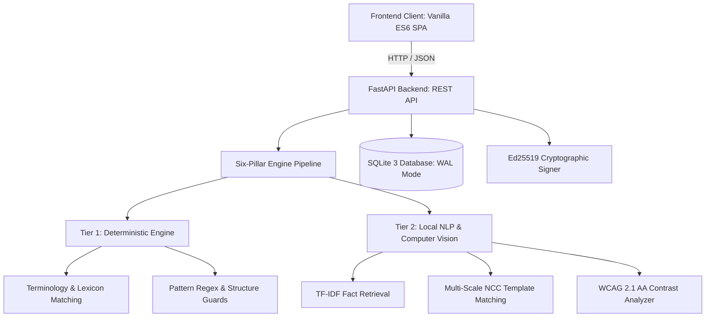

# LOOMSHIELD — SYSTEM ARCHITECTURE & TECHNICAL SPECIFICATION

This document details the architectural design, component subsystems, data flows, and security boundaries of LoomShield.

---

## 1. ARCHITECTURAL OVERVIEW

LoomShield is a brand governance and compliance validation workspace designed for enterprise marketing copy, technical documentation, and visual brand assets. It provides deterministic, zero-cloud verification against immutable Brand Vault rulesets with cryptographic audit trails.

---

## 2. SUBSYSTEM ARCHITECTURE

### 2.1 Frontend Client (Single-Page Application)
- **Tech Stack:** Vanilla HTML5, CSS3, ES6 JavaScript. Zero external npm build dependencies or CDN runtimes.
- **Design System:** Soft Glass aesthetic with strict tokenization (`--glass-bg`, `--glass-blur`, `--radius-card`, `--radius-control`). Enforces a maximum of 3 concurrent `backdrop-filter` elements to guarantee 60 FPS rendering on mobile devices.
- **Self-Hosted Typography:** WOFF2 variable fonts (`InterVariable.woff2` for body text, `GeistMono-Variable.woff2` for identifiers, hashes, and versions) served directly by the backend to eliminate external telemetry calls.
- **SPA Hash Router:** Centralized routing handling `#/overview`, `#/new-audit`, `#/audit/AUD-XXXX`, `#/vault`, `#/queue`, `#/insights`, `#/history`, `#/settings`, and `#/verify`. Prevents hardcoded ID fallbacks and handles browser history gracefully.
- **Concurrency & Double-Click Guards:** All mission-critical action buttons (Run audit, Workflow transitions, Certificate issuance, Revision approval) employ disable-on-click and `data-busy` locks to eliminate duplicate submissions.
- **Session Continuity:** Demo user sessions persist across page refreshes via `sessionStorage`, automatically cleared upon 401 expiration.

### 2.2 Backend API (FastAPI)
- **Framework:** FastAPI running on Uvicorn with standard Pydantic models.
- **Database Engine:** SQLite 3 with Write-Ahead Logging (`PRAGMA journal_mode = WAL;`) and enforced referential integrity (`PRAGMA foreign_keys = ON;`).
- **Idempotent Migrations:** Database migrations execute sequentially and idempotently on startup without dropping tables or losing historical audit records.
- **Reverse Proxy Anti-Spoofing:** Client IP resolution uses right-to-left hop parsing governed by `LOOMSHIELD_TRUSTED_PROXY_HOPS` (default: 1) and optional provider headers (e.g. `CF-Connecting-IP`), preventing spoofed `X-Forwarded-For` injection.
- **Sliding-Window Rate Limiting:** In-memory rate limiting across upload, audit, and reset routes with automatic key eviction.

---

## 3. SIX-PILLAR INSPECTION ENGINE PIPELINE

Every content submission is evaluated across six compliance pillars:

| Pillar | Detection Tiers | Core Mechanism | Verification Tests |
| :--- | :--- | :--- | :--- |
| **1. Terminology** | Tier 1 (Deterministic) | Case-sensitive lexicon lookup, word-boundary regex, prohibited term dictionary, punctuation trimming. | `test_cycle1_A1_correct_preferred_terminology` |
| **2. Promotional Claims** | Tier 1 + Tier 2 (Pattern + Local NLP) | Number extraction, unit conflict detection, TF-IDF vectorization with cosine similarity against Brand Vault verified facts. | `test_cycle1_B1_approved_numerical_claim` |
| **3. Tone and Voice** | Tier 1 + Tier 2 (Dictionary + Polarity) | Domain-specific vague lexicon analysis, rule ambiguity scoring, alarmist pattern detection. | `test_b1_scorer_determinism_with_golden_fixtures` |
| **4. Messaging Principles** | Tier 1 (Deterministic) | Mandatory human-oversight clause checks, prohibited messaging themes, structure enforcement. | `test_cycle1_B10_claims_that_require_human_verification_pending_fact` |
| **5. Visual Consistency** | Tier 1 + Tier 2 (Math + Template Match) | Multi-scale Normalized Cross-Correlation (NCC) logo matching ($0.5\times$ to $2.0\times$), CIE Delta-E palette clustering, clear space ratio calculation. | `test_h2_heatmap_fixture_suite_against_expected_json` |
| **6. Accessibility** | Tier 1 (Deterministic Math) | WCAG 2.1 AA relative luminance contrast ratios ($4.5:1$ normal, $3.0:1$ large), heading hierarchy jump detection, image alt-text presence. | `test_cycle1_C1_sufficient_text_contrast` |

---

## 4. SECURITY & CRYPTOGRAPHY SPECIFICATION

### 4.1 Ed25519 Compliance Certificates (Version 2)
Approved audits produce immutable compliance certificates:
- **Signing Algorithm:** Ed25519 (RFC 8032) using pure cryptographic primitives.
- **Canonical Serialization:** Payloads are canonicalized per RFC 8785 (deterministic key order, strict Unicode escaping, no extraneous whitespace).
- **Invariance:** Any byte modification to the audit ID, content SHA-256, brand version, approver identity, or submitter identity immediately breaks signature verification (`test_certificate_flipping_any_payload_byte_invalid`).
- **Revocation Ledger:** Public certificate status lookup (`GET /api/certificates/{id}/status`) allows verifying current validity without exposing sensitive content hashes.

### 4.2 Separation of Duties
To protect organizational integrity, LoomShield enforces separation of duties:
- The actor who submitted an audit for review (`submitted_by_user_id`) cannot approve that audit (`test_self_approval_blocked_and_different_reviewer_succeeds`).
- Audit approval requires an independent reviewer or Brand Administrator with documented override justification if open findings remain.

### 4.3 Upload Safety & Memory Budgeting
- **Chunked Upload Abort:** Large request payloads abort at 5 MB + 1 byte (`test_f2_chunked_upload_aborts_at_5mb_plus_1_byte_on_6mb_body`).
- **Pixel Cap Guard:** Raster images over 12.0 megapixels ($12,000,000$ pixels) are rejected before full decoding (`test_g2_image_cap_12mp_accepted_and_12mp_plus_1px_rejected`).
- **Peak RSS Footprint:** Memory usage during image processing stays strictly under 150 MB (`test_g2_image_cap_12mp_accepted_and_12mp_plus_1px_rejected`).
- **XML / SVG Sanitization:** XML external entity (XXE) expansion and script execution are stripped before SVG parsing (`test_cycle6_privacy_and_security_tests_1_to_7`).
