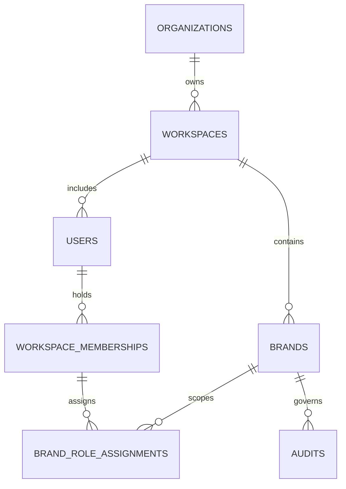

# LoomShield Identity & Multi-Tenant Authorization Plan

**Version:** 1.0 (Phase 1 Baseline)  
**Author:** LoomShield Engineering  
**Scope:** Architecture Roadmap for Production Identity, Organization Tenancy, and Granular Brand Governance

---

## 1. Context & Objectives

In the current standalone build, LoomShield enforces role permissions on the server using environment configuration (`LOOMSHIELD_USER_ROLE` and `LOOMSHIELD_USER_NAME`) with client role preview enabled strictly in isolated demo mode (`LOOMSHIELD_WORKSPACE_MODE=demo`).

While this model eliminates client-trusted privilege escalation, production enterprise deployments require multi-tenant isolation, user accounts, SSO authentication, and per-brand access controls. This document defines the target data model, authentication flow, and migration strategy.

---

## 2. Target Entity-Relationship Model



### 2.1 Core Entities

1. **`organizations`**
   - `id`: UUID (e.g. `org_9a1f2c...`)
   - `name`: Organization name (e.g. "Acme Global Treasury")
   - `slug`: Subdomain or tenant slug
   - `tier`: Enterprise / Standard
   - `created_at`: ISO timestamp

2. **`users`**
   - `id`: UUID
   - `email`: Normalized lowercase email (Unique index)
   - `display_name`: Full name
   - `auth_provider`: Local, OIDC, SAML, Google Workspace
   - `is_active`: Boolean
   - `created_at`: ISO timestamp

3. **`workspaces`**
   - `id`: UUID
   - `org_id`: Foreign key -> `organizations.id`
   - `name`: Workspace title
   - `mode`: `"production"` | `"demo"`
   - `created_at`: ISO timestamp

4. **`workspace_memberships`**
   - `id`: UUID
   - `user_id`: Foreign key -> `users.id`
   - `workspace_id`: Foreign key -> `workspaces.id`
   - `org_role`: `"Org Admin"` | `"Member"` | `"Auditor"`
   - Unique constraint: `(user_id, workspace_id)`

5. **`brand_role_assignments`**
   - `id`: UUID
   - `user_id`: Foreign key -> `users.id`
   - `brand_id`: Foreign key -> `brands.id`
   - `brand_role`: `"Content Creator"` | `"Reviewer"` | `"Brand Administrator"`
   - Unique constraint: `(user_id, brand_id)`

---

## 3. Permissions Hierarchy & Capabilities

| Permission Key | Content Creator | Reviewer | Brand Administrator | Org Admin |
| :--- | :---: | :---: | :---: | :---: |
| `run_audits` (Text & File Upload) | Yes | Yes | Yes | Yes |
| `apply_corrections` | Yes | Yes | Yes | Yes |
| `dismiss_findings` | Yes | Yes | Yes | Yes |
| `submit_for_review` | Yes | Yes | Yes | Yes |
| `request_changes` | No | Yes | Yes | Yes |
| `approve` (Zero unresolved) | No | Yes | Yes | Yes |
| `approve_with_override` | No | Yes | Yes | Yes |
| `edit_brand_vault` (Rules, Terms, Colors) | No | No | Yes | Yes |
| `propose_facts` | Yes | Yes | Yes | Yes |
| `verify_facts` | No | No | Yes | Yes |
| `manage_brands` (Create, Archive) | No | No | Yes | Yes |
| `manage_team_roles` | No | No | No | Yes |
| `view_audit_events_and_telemetry` | Scoped | Scoped | All Brand | All Workspace |

---

## 4. Authentication & Session Lifecycles

### 4.1 Token Issuance & Verification
- **Protocol:** JWT (JSON Web Token) with RS256 asymmetric signing.
- **Header:** `Authorization: Bearer <access_token>`
- **Token Claims:**
  ```json
  {
    "sub": "usr_8829141f",
    "org": "org_9a1f2c",
    "ws": "ws_110294",
    "name": "Jane Doe",
    "email": "jane@example.com",
    "exp": 1771948800,
    "brand_roles": {
      "novapay": "Brand Administrator",
      "verdant": "Reviewer"
    }
  }
  ```
- **Fallback / Legacy Compatibility:**
  If no Authorization header is present, the server inspects `LOOMSHIELD_WORKSPACE_MODE`.
  - In `demo` mode, evaluator role preview via `x-loomshield-role` continues to function.
  - In `production` standalone mode, server configuration dictates default role.

---

## 5. Migration Strategy

1. **Phase 1 (Current):**
   - Server-enforced role resolution; client-supplied role bodies ignored.
   - `check_brand_access()` helper invoked across all brand endpoints.
   - Least privilege default for unconfigured deployments.
2. **Phase 2 (Database Migration):**
   - Add `users`, `workspaces`, and `brand_role_assignments` tables in SQLite/Postgres.
   - Add `workspace_id` column to `brands` and `audits`.
3. **Phase 3 (Auth Handler):**
   - Implement `/api/auth/login`, `/api/auth/callback`, and OAuth/SAML middleware.
   - Inject verified `UserSession` into FastAPI request state.
